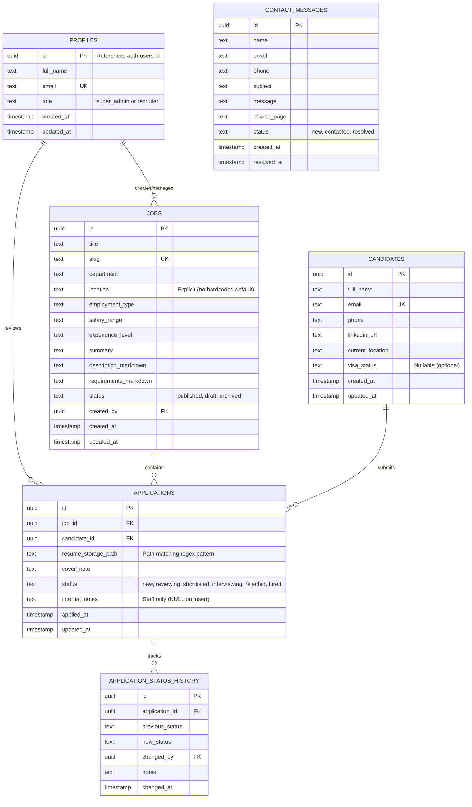

# Database Schema & Data Architecture — Solavanta Careers

## 1. Overview
The Solavanta Careers platform utilizes a **normalized, hardened PostgreSQL database** hosted via Supabase.

All tables are strictly protected by **PostgreSQL Row-Level Security (RLS)** and atomic Remote Procedure Calls (RPCs):
- Public visitors can submit contact inquiries and job applications through hardened validation gates.
- Public visitors cannot read any candidate applications, resumes, or internal evaluation notes.
- Only authenticated users with an authorized `admin` or `recruiter` role can view applications, update statuses, manage vacancies, and download candidate resumes.

---

## 2. Entity-Relationship Diagram

---

## 3. Data Integrity & Validation Constraints

To prevent malformed or malicious data injection, every column has strict database-level check constraints:
* **Email Constraints**: `email ~* '^[A-Za-z0-9._%+-]+@[A-Za-z0-9.-]+\.[A-Za-z]{2,}$'` prevents invalid email syntax.
* **String Bounds**: `char_length(name) BETWEEN 2 AND 150`, `char_length(message) BETWEEN 5 AND 4000` prevents database buffer bloat.
* **Slug Constraints**: `slug ~* '^[a-z0-9]+(?:-[a-z0-9]+)*$'` guarantees clean URL slugs for search engine optimization.
* **Resume Path Regex**: `resume_storage_path ~* '^resumes/[a-f0-9-]+/[a-f0-9-]+_[a-zA-Z0-9_-]+\.(pdf|docx)$'` ensures resumes strictly follow structured, non-arbitrary paths.

---

## 4. Application Submission via Atomic Stored Procedure (`submit_candidate_application`)
Rather than relying on uncoordinated direct client `INSERT` calls, applications are processed atomically in a single PostgreSQL transaction:
1. Verifies that the specified `job_id` exists and is actively `published`.
2. Verifies that the resume path matches the approved bucket format.
3. Inserts or finds the candidate by unique email.
4. Enforces that the candidate has not already applied for this specific job (`uq_candidate_job`).
5. Inserts the application strictly with `status = 'new'` and `internal_notes = NULL`.

Anonymous users have zero direct `INSERT` permissions on `candidates` or `applications` tables, rendering client-side tampering impossible.
