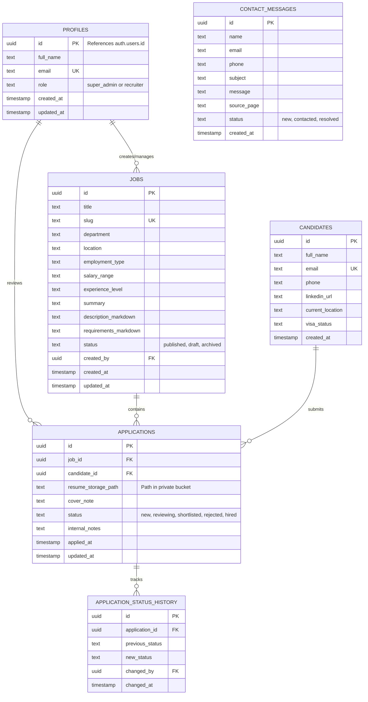

# Database Schema & Data Architecture — Solavanta Careers

## 1. Overview
The Solavanta Careers platform utilizes a **normalized PostgreSQL database** hosted via Supabase.

All tables are strictly protected by **PostgreSQL Row-Level Security (RLS)** to enforce privacy boundaries:
- Public visitors can submit contact inquiries and job applications.
- Public visitors cannot read any candidate applications, resumes, or internal notes.
- Only authenticated users with an authorized `admin` or `recruiter` role can view applications, update statuses, manage vacancies, and download candidate resumes.

---

## 2. Entity-Relationship Diagram

---

## 3. Detailed Table Specifications

### Table 1: `profiles`
Stores administrator and recruiter account metadata, mapped directly to Supabase Auth (`auth.users`).
* `id` (`UUID`, Primary Key): References `auth.users(id)` with `ON DELETE CASCADE`.
* `full_name` (`TEXT`, Not Null): Administrator's full name.
* `email` (`TEXT`, Not Null, Unique): Administrator's verified login email.
* `role` (`TEXT`, Not Null, Default `'recruiter'`): Permission tier (`'super_admin'` or `'recruiter'`).
* `created_at` (`TIMESTAMPTZ`, Default `NOW()`): Account creation timestamp.
* `updated_at` (`TIMESTAMPTZ`, Default `NOW()`): Last profile update.

### Table 2: `jobs`
Stores career openings and track descriptions shown on the public job board.
* `id` (`UUID`, Primary Key, Default `gen_random_uuid()`): Unique vacancy identifier.
* `title` (`TEXT`, Not Null): Job title (e.g., "Full-Stack Cloud Engineer").
* `slug` (`TEXT`, Not Null, Unique): Clean URL slug (e.g., `"full-stack-cloud-engineer"`).
* `department` (`TEXT`, Not Null): Department (e.g., `"Software Engineering"`, `"Data Science"`).
* `location` (`TEXT`, Not Null, Default `'London, UK (Hybrid)'`): Work location.
* `employment_type` (`TEXT`, Not Null, Default `'Full-time'`): Full-time, Contract, etc.
* `salary_range` (`TEXT`): Disclosed salary benchmark (e.g., `"£65,000 – £85,000"`).
* `experience_level` (`TEXT`): Experience expectation (e.g., `"Junior / Mid"`, `"Senior"`).
* `summary` (`TEXT`, Not Null): Short card description.
* `description_markdown` (`TEXT`, Not Null): Comprehensive job details.
* `requirements_markdown` (`TEXT`, Not Null): Bulleted criteria and qualifications.
* `status` (`TEXT`, Not Null, Default `'draft'`): Allowed values: `'draft'`, `'published'`, `'archived'`.
* `created_by` (`UUID`, Foreign Key): References `profiles(id)`.
* `created_at` (`TIMESTAMPTZ`, Default `NOW()`): Listing publication date.
* `updated_at` (`TIMESTAMPTZ`, Default `NOW()`): Last updated timestamp.

### Table 3: `candidates`
Stores unique candidate contact records, preventing duplicate applicant profiles.
* `id` (`UUID`, Primary Key, Default `gen_random_uuid()`): Unique candidate ID.
* `full_name` (`TEXT`, Not Null): Candidate's full name.
* `email` (`TEXT`, Not Null, Unique): Candidate's email address (enforces uniqueness).
* `phone` (`TEXT`, Not Null): Contact telephone number.
* `linkedin_url` (`TEXT`): Optional LinkedIn profile link.
* `current_location` (`TEXT`): City/Country of candidate.
* `visa_status` (`TEXT`): E.g., `"UK Graduate Visa"`, `"Skilled Worker"`, `"Citizen / Settled"`.
* `created_at` (`TIMESTAMPTZ`, Default `NOW()`): Initial registration timestamp.

### Table 4: `applications`
Connects a candidate to a specific job vacancy with their resume and application status.
* `id` (`UUID`, Primary Key, Default `gen_random_uuid()`): Unique application ID.
* `job_id` (`UUID`, Not Null, Foreign Key): References `jobs(id)` on delete restrict.
* `candidate_id` (`UUID`, Not Null, Foreign Key): References `candidates(id)` on delete cascade.
* `resume_storage_path` (`TEXT`, Not Null): File path inside the private Supabase Storage bucket (`resumes/`).
* `cover_note` (`TEXT`): Candidate introduction or message.
* `status` (`TEXT`, Not Null, Default `'new'`): Current stage (`'new'`, `'reviewing'`, `'shortlisted'`, `'interviewing'`, `'rejected'`, `'hired'`).
* `internal_notes` (`TEXT`): Private recruiter evaluation notes (never visible to candidates).
* `applied_at` (`TIMESTAMPTZ`, Default `NOW()`): Application submission date.
* `updated_at` (`TIMESTAMPTZ`, Default `NOW()`): Status update date.

### Table 5: `application_status_history`
Maintains an immutable audit log of status updates for accountability.
* `id` (`UUID`, Primary Key, Default `gen_random_uuid()`): Audit log ID.
* `application_id` (`UUID`, Not Null, Foreign Key): References `applications(id)` on delete cascade.
* `previous_status` (`TEXT`, Not Null): Status prior to update.
* `new_status` (`TEXT`, Not Null): New assigned status.
* `changed_by` (`UUID`, Foreign Key): References `profiles(id)` identifying who made the change.
* `changed_at` (`TIMESTAMPTZ`, Default `NOW()`): Audit event timestamp.

### Table 6: `contact_messages`
Stores customer inquiries submitted from all public contact and consultation forms.
* `id` (`UUID`, Primary Key, Default `gen_random_uuid()`): Message ID.
* `name` (`TEXT`, Not Null): Sender full name.
* `email` (`TEXT`, Not Null): Sender email address.
* `phone` (`TEXT`): Sender phone number.
* `subject` (`TEXT`): Inquiry topic or department.
* `message` (`TEXT`, Not Null): Message body or consultation request.
* `source_page` (`TEXT`, Not Null): Identifies origin page (`'index'`, `'why-solavanta'`, `'hire-talent'`, `'refer'`).
* `status` (`TEXT`, Not Null, Default `'new'`): Allowed values: `'new'`, `'contacted'`, `'resolved'`.
* `created_at` (`TIMESTAMPTZ`, Default `NOW()`): Timestamp of inquiry.

---

## 4. Key Indexes for Fast Queries
* `CREATE INDEX idx_jobs_status_slug ON jobs(status, slug);`
* `CREATE INDEX idx_applications_job_id ON applications(job_id);`
* `CREATE INDEX idx_applications_candidate_id ON applications(candidate_id);`
* `CREATE INDEX idx_applications_status ON applications(status);`
* `CREATE INDEX idx_contact_messages_status ON contact_messages(status);`
