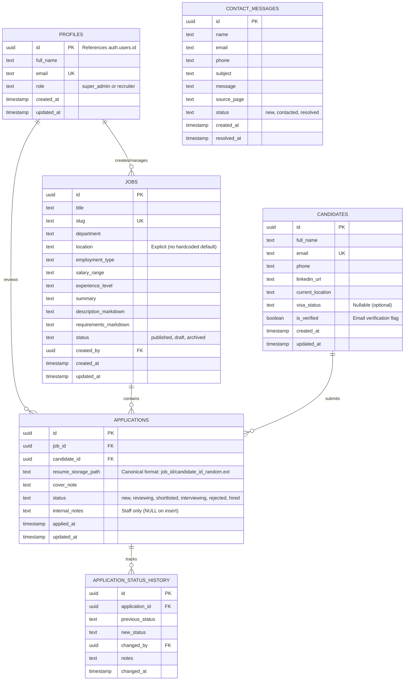

# Database Schema & Data Architecture — Solavanta Careers

## 1. Overview
The Solavanta Careers platform utilizes a **normalized, hardened PostgreSQL database** hosted via Supabase.

All tables are strictly protected by **PostgreSQL Row-Level Security (RLS)**, explicit privilege revocations, and atomic Remote Procedure Calls (RPCs):
- Public visitors submit contact inquiries and job applications through hardened validation gates.
- Public visitors cannot read any candidate applications, resumes, or internal evaluation notes.
- Only authenticated users with an authorized `admin` or `recruiter` role can view applications, update statuses, manage vacancies, and download candidate resumes.

---

## 2. Entity-Relationship Diagram

---

## 3. Canonical Storage Path Symmetrical Definition

To eliminate path drift, the resume storage path is canonically defined relative to the private `resumes` bucket:

$$\text{Canonical Path Format} = \underbrace{\text{job\_uuid}}_{36\text{ chars}} \,/\, \underbrace{\text{candidate\_uuid}}_{36\text{ chars}} \text{\_} \underbrace{\text{random\_hex}}_{\text{unique}} \text{.} \underbrace{\text{(pdf}|\text{docx)}}_{\text{extension}}$$

* **Database Constraint** on `applications.resume_storage_path`:
  `CHECK (resume_storage_path ~* '^[a-f0-9]{8}-[a-f0-9]{4}-[a-f0-9]{4}-[a-f0-9]{4}-[a-f0-9]{12}/[a-f0-9]{8}-[a-f0-9]{4}-[a-f0-9]{4}-[a-f0-9]{4}-[a-f0-9]{12}_[a-zA-Z0-9_-]+\.(pdf|docx)$')`
* **Storage RLS Policy** on `storage.objects.name`:
  `CHECK (bucket_id = 'resumes' AND name ~* '^[a-f0-9]{8}-[a-f0-9]{4}-[a-f0-9]{4}-[a-f0-9]{4}-[a-f0-9]{12}/[a-f0-9]{8}-[a-f0-9]{4}-[a-f0-9]{4}-[a-f0-9]{4}-[a-f0-9]{12}_[a-zA-Z0-9_-]+\.(pdf|docx)$')`
* **Stored Procedure Verification**:
  Inside `submit_candidate_application`, before inserting the application, the procedure verifies:
  `SELECT EXISTS (SELECT 1 FROM storage.objects WHERE bucket_id = 'resumes' AND name = p_resume_storage_path)`
  If the file was not genuinely uploaded, the application is rejected immediately.

---

## 4. Candidate Identity Protection Workflow

1. **No Anonymous Overwrites**: When an application is submitted, if a candidate with the supplied email already exists:
   - The system attaches the application to that existing candidate ID.
   - The existing candidate's phone, name, and profile details **remain unchanged**.
   - Anonymous visitors cannot alter another candidate's personal contact record.
2. **Duplicate Prevention**: If the candidate has already applied to that exact job vacancy, the database raises an error (`P0004`) preventing duplicate submissions.
3. **Profile Modification**: Updating personal contact records will require candidate email authentication (OTP / Magic Link) in Phase 4.
