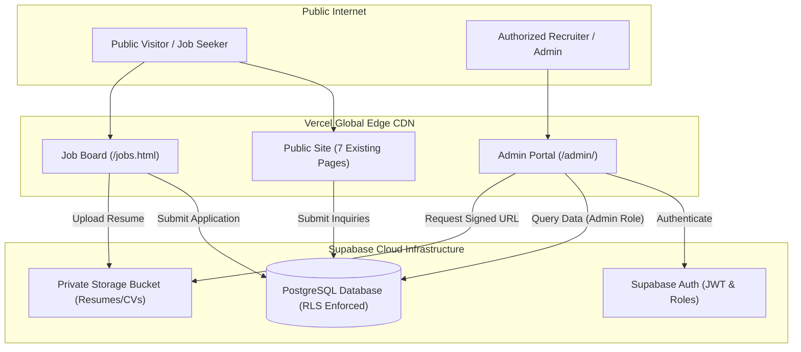

# Project Architecture — Solavanta Careers

## 1. High-Level System Overview
Solavanta Careers is a commercial tech placement and career acceleration platform designed for international graduates and engineers seeking high-paying tech roles.

The platform is designed around a **Separation of Concerns** principle:
- **Public Frontend**: High-performance, SEO-optimized static HTML5, CSS3, and modern JavaScript hosted on Vercel edge infrastructure.
- **Backend-as-a-Service (BaaS)**: Supabase, providing an enterprise-grade PostgreSQL database, secure JWT authentication, and private encrypted object storage.
- **Admin Portal**: A secure, authenticated dashboard allowing authorized recruiters and administrators to manage job listings, review candidate applications, download resumes via signed URLs, and handle inquiries.



---

## 2. Technology Choices Explained Simply

### Why Keep HTML/CSS/JavaScript Initially?
- **Speed & Simplicity**: Plain HTML/CSS/JS loads instantly with zero compilation delays, zero runtime framework bundle overhead, and optimal Core Web Vitals.
- **Design Preservation**: The existing visual design is already custom-tailored and responsive. Migrating to React at this stage would introduce high migration risk without added business value for public content pages.
- **Direct Supabase Integration**: Supabase provides a lightweight client library (`@supabase/supabase-js`) that works directly in vanilla JavaScript in the browser.

### Why Supabase (PostgreSQL)?
- **PostgreSQL**: The world's most trusted, ACID-compliant relational database.
- **Row-Level Security (RLS)**: Security rules are enforced directly at the database engine level. Even if frontend code is inspected, users can only read or write what their permission rule allows.
- **Built-in Authentication**: Secure user sessions, password hashing (bcrypt), and role management handled by industry-standard protocols.
- **Private File Storage**: Resumes are kept in private, non-public storage buckets and accessed only through time-limited signed URLs.

### Why Vercel?
- **Global CDN**: Serves pages from servers close to visitors around the world in milliseconds.
- **Automated SSL/TLS**: Free, automatic HTTPS certificates.
- **Git Integration**: Pushing to the `main` branch automatically deploys updates safely.

---

## 3. Directory Structure (Proposed Production Architecture)

```
solavanta-careers/
│
├── .gitignore                    # Prevents sensitive files & secrets from entering Git
├── .env.example                  # Safe template for environment variables
├── vercel.json                   # Vercel routing and header configuration
├── README.md                     # Project overview and developer setup guide
│
├── index.html                    # Homepage
├── why-solvanta.html             # About & Differentiators page
├── placement-plan.html           # 12 Career Tracks & Pricing
├── resources.html                # Career Knowledge Hub
├── success-stories.html          # Candidate Placements & Reviews
├── refer-and-earn.html           # £500 Referral Program
├── hire-talent.html              # Employer Portal
│
├── jobs/                         # (Phase 5) Public Job Board & Application Views
│   ├── index.html                # Searchable job openings listing
│   └── job-detail.html           # Dynamic vacancy description & application form
│
├── admin/                        # (Phase 7 & 8) Secure Administrative Dashboard
│   ├── index.html                # Admin authentication login portal
│   ├── dashboard.html            # Main metrics & application pipeline
│   ├── jobs.html                 # Job listing editor (create, edit, archive)
│   ├── candidates.html           # Candidate profile view & resume viewer
│   └── messages.html             # Contact inquiry manager
│
├── assets/                       # Static Design & Media Assets
│   ├── css/
│   │   ├── vendor.min.css        # Bundled vendor styles (Bootstrap, Swiper)
│   │   ├── style.css             # Solavanta core layout stylesheet
│   │   └── read-more.css         # Text expander styling
│   ├── js/
│   │   ├── jquery.min.js         # Core jQuery
│   │   ├── vendor.min.js         # Bundled vendor scripts (Bootstrap, Swiper)
│   │   ├── custom.js             # Site UI interactions, animations, carousels
│   │   └── supabase-client.js    # (Phase 4) Centralized Supabase initialization
│   ├── fonts/                    # Icon & web font files
│   └── images/                   # Optimized branding, photos, icons, and illustrations
│
└── docs/                         # Comprehensive Project Documentation
    ├── PROJECT_ARCHITECTURE.md   # This document
    ├── DATABASE_SCHEMA.md        # PostgreSQL tables, relations, and indexes
    ├── SECURITY.md               # Security, RLS policies, and privacy compliance
    ├── DEPLOYMENT.md             # Vercel & Supabase setup instructions
    ├── CLIENT_HANDOVER.md        # Ownership, maintenance, and credentials guide
    └── DEVELOPMENT_PROGRESS.md   # 14-Phase status tracking log
```
