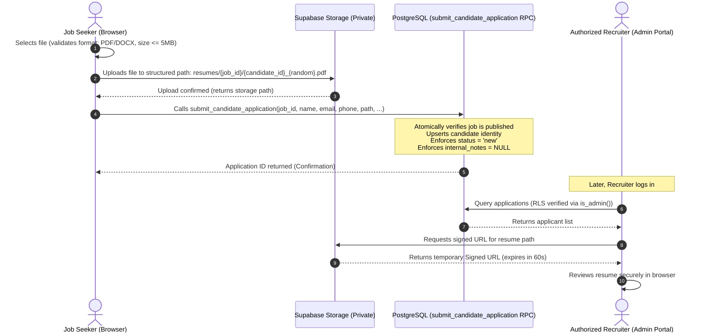

# Security Architecture & Data Protection — Solavanta Careers

## 1. Security Philosophy & Threat Model
Solavanta Careers is a commercial career placement platform handling candidate identities, CVs, telephone numbers, and employment histories.

Our security model follows the **Principle of Defense in Depth**:
* **Database Layer**: Hardened Row-Level Security (RLS) policies, atomic stored procedures with explicit `search_path = public, pg_temp`, and column check constraints.
* **Storage Layer**: A strictly private storage bucket (`resumes`) rejecting arbitrary file paths, enforcing 5MB size limits, and permitting only `.pdf` and `.docx` MIME extensions. Access is granted solely through time-limited (60-second) cryptographic Signed URLs.
* **Application Layer**: Zero exposure of Service Role keys in frontend code; input sanitization against Cross-Site Scripting (XSS); honeypot protection against spam bots.
* **Administrative Layer**: Secure, out-of-band bootstrapping for the initial Super Administrator with zero public self-registration.

---

## 2. Secure First Admin Bootstrap Procedure

Under no circumstances should the system allow public registration of administrator accounts.

### Step-by-Step Secure Bootstrap:
1. **Create Identity in Supabase Auth**:
   - The project owner navigates to **Supabase Dashboard $\to$ Authentication $\to$ Users $\to$ Invite User** (or "Add User").
   - Enter the client's authorized corporate email (e.g., `admin@solavantacareers.com`) and generate a strong 20+ character random password.
2. **Assign Super Admin Role via SQL Editor**:
   - In Supabase SQL Editor (which has `postgres` superuser access), run the one-time bootstrap script:
     ```sql
     INSERT INTO public.profiles (id, full_name, email, role)
     SELECT id, 'Lead Administrator', email, 'super_admin'
     FROM auth.users
     WHERE email = 'admin@solavantacareers.com'
     ON CONFLICT (id) DO UPDATE SET role = 'super_admin';
     ```
3. **Protection Against Privilege Escalation**:
   - The RLS policy on `public.profiles` restricts `INSERT` and `UPDATE` of profiles exclusively to existing `super_admin` accounts.
   - An anonymous user or regular recruiter cannot grant themselves administrative privileges.

---

## 3. Candidate Application & Resume Upload Workflow



---

## 4. Remediation Matrix: Identified Vulnerabilities & Hardening

| # | Vulnerability Identified | Severity | Remediation Implemented in Phase 3 |
| :--- | :--- | :--- | :--- |
| **1** | **Direct Public INSERT with `WITH CHECK (true)` on `applications`** | **CRITICAL** | Removed direct public INSERT on `applications`. Applications can now only be submitted through the atomic `submit_candidate_application` stored procedure, which hardcodes `status = 'new'` and `internal_notes = NULL`. |
| **2** | **Direct Public INSERT with `WITH CHECK (true)` on `candidates`** | **HIGH** | Removed direct public INSERT on `candidates`. Candidate registration is consolidated atomically inside `submit_candidate_application`, preventing fake orphan records. |
| **3** | **Unrestricted Upload Paths in `resumes` Storage Bucket** | **HIGH** | Replaced `WITH CHECK (bucket_id = 'resumes')` with strict path regex: `^[a-f0-9-]+/[a-f0-9-]+_[a-zA-Z0-9_-]+\.(pdf|docx)$` and lowercase extension validation. |
| **4** | **Tampering with `contact_messages` status** | **MEDIUM** | Enforced `WITH CHECK (status = 'new' AND resolved_at IS NULL)` so visitors cannot mark inquiries as resolved or fabricate resolution timestamps. |
| **5** | **Unsafe `search_path` on `SECURITY DEFINER` functions** | **HIGH** | Explicitly set `SET search_path = public, pg_temp` on `handle_updated_at`, `log_application_status_change`, `is_admin`, and `submit_candidate_application` to prevent CVE-class privilege hijacking. |
| **6** | **Unvalidated Input Strings** | **MEDIUM** | Added check constraints enforcing email regex, name length bounds (2–150 chars), message length bounds (5–4000 chars), and clean URL slugs. |
| **7** | **Unjustified Hardcoded Defaults** | **LOW** | Removed hardcoded `'London, UK (Hybrid)'` default from `jobs.location` to force explicit vacancy locations; made `visa_status` optional (`NULL`) for domestic applicants. |
